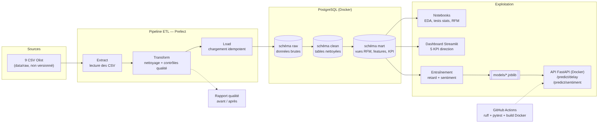

# ShopPulse — Mission Flash Data & IA

> Plateforme data & IA réduite pour ShopPulse, marketplace e-commerce (données : Brazilian E-Commerce Public Dataset by Olist).

**Auteur :** Matteo Bruno — Bachelor Data & IA, HETIC
**Rendu :** 2 novembre, 17h00

## Pitch

ShopPulse n'a ni vision consolidée de ses données, ni segmentation client, et découvre ses retards de livraison via les avis négatifs. Ce projet livre :

1. une base PostgreSQL consolidée et fiable, alimentée par un pipeline rejouable ;
2. des réponses métier lisibles (dashboard, personas, campagnes) ;
3. deux modèles (retard de livraison, sentiment des avis) servis par une API FastAPI conteneurisée.

## Architecture



Source du schéma : `docs/architecture.mmd` (Mermaid). Choix techniques justifiés dans `docs/arbitrage.md`.

## Installation

Prérequis : Python 3.11, Docker, un compte Kaggle.

```bash
git clone <url-du-depot> && cd shoppulse
cp .env.example .env
python -m venv .venv && source .venv/bin/activate
pip install -e ".[dev]"
```

Télécharger les données : voir `data/README.md`.

## Lancement

```bash
# Base de données
docker compose -f infra/docker-compose.yml up -d db

# API (conteneurisée)
docker compose -f infra/docker-compose.yml up --build api
# Documentation OpenAPI : http://localhost:8000/docs
```

## Tests et qualité

```bash
ruff check .
pytest
```

## Démo

_Captures du dashboard à ajouter dans `dashboards/`._

## Usage de l'IA

_À compléter honnêtement : quels outils d'IA ont été utilisés, pour quelles parties, et ce qui a été vérifié ou réécrit à la main._
