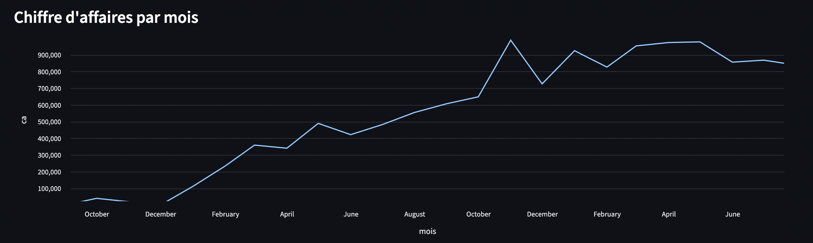
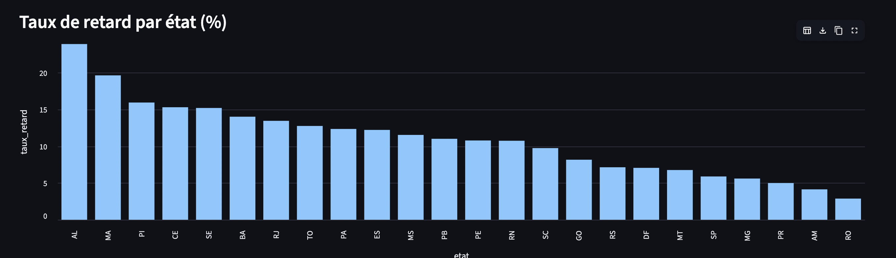
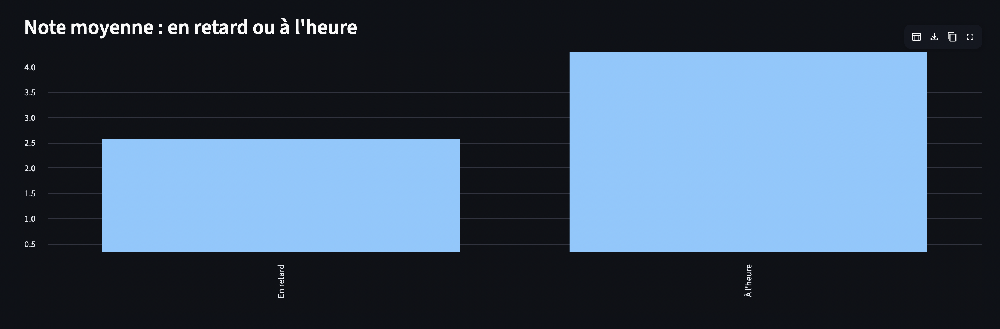

# ShopPulse — Mission Flash Data & IA

> Plateforme data & IA réduite pour ShopPulse, marketplace e-commerce (données : Brazilian E-Commerce Public Dataset by Olist).

**Auteur :** Matteo Bruno — Bachelor Data & IA, HETIC
**Rendu :** 2 novembre, 17h00

## Pitch

ShopPulse n'a ni vision consolidée de ses données, ni segmentation client, et découvre ses retards de livraison via les avis négatifs. Ce projet livre :

1. une base PostgreSQL consolidée et fiable, alimentée par un pipeline rejouable ;
2. des réponses métier lisibles (dashboard, personas, campagnes) ;
3. deux modèles (retard de livraison, sentiment des avis) servis par une API FastAPI conteneurisée.

## Architecture


Source du schéma : `docs/architecture.mmd` (Mermaid). Choix techniques justifiés dans `docs/arbitrage.md`.

## Installation

Prérequis : Python 3.11, Docker, un compte Kaggle.

```bash
git clone <url-du-depot> && cd shoppulse
cp .env.example .env
python -m venv .venv
source .venv/bin/activate      # Windows : .venv\Scripts\activate
pip install -e ".[dev,pipeline]"
```

Télécharger les données : voir `data/README.md`.

## Lancement

```bash
# Base de données (PostgreSQL exposé sur le port 5433)
docker compose -f infra/docker-compose.yml up -d db

# Pipeline ETL : raw, clean, mart et rapport qualité (rejouable sans doublons)
python pipelines/etl_flow.py

# Entraînement des deux modèles (enregistrés dans models/, non versionnés)
# À lancer AVANT de construire l'image de l'API
python pipelines/train_models.py

# Dashboard direction (http://localhost:8501)
python -m streamlit run dashboards/app.py

# API (conteneurisée)
docker compose -f infra/docker-compose.yml up --build api
# Documentation OpenAPI : http://localhost:8000/docs
```

Les notebooks `notebooks/01` à `05` détaillent l'analyse (EDA, segmentation, comparaison
des modèles, audit d'équité). Ils lisent la base remplie par le pipeline.

## Tests et qualité

```bash
ruff check .
pytest
```

## Démo

Dashboard direction (`python -m streamlit run dashboards/app.py`) : 5 KPI (chiffre d'affaires, commandes, panier moyen, taux de retard, note moyenne), filtrables par année.






## Usage de l'IA

Je me suis servi de Claude (Anthropic) comme assistant sur tout le projet. Au début,
surtout pour m'organiser : découper le travail en jours, planifier les commits, poser
l'architecture. Ensuite, quand j'ai pris du retard en début de semaine, je lui ai fait
générer une bonne partie du code dans un but ludique et d'apprentissage en me mettant des trous dans le code
pour que je puisse savoir ce que je fais et aussi pour pour tenir les délais : les notebooks
(EDA, segmentation, modèles), l'API et les tests. Il m'a aussi aidé à
rédiger un premier jet de la note éthique et de la rétro.

De mon côté, j'ai écrit moi-même, les requêtes SQL, le dashboard, le schéma raw et le premier script de chargement, et j'ai monté toute la partie environnement (Docker, Postgres, le .env, VS Code), ce qui m'a
donné pas mal de fil à retordre (conflit de port, mot de passe, kernel Jupyter...).
J'ai lancé chaque étape sur les vraies données, vérifié les résultats avant de les
commiter, et géré tout le Git : branches, commits, PR, backlog. J'ai aussi fait les
choix finaux, comme garder la régression logistique pour le sentiment, ou demander un
code plus simple pour pouvoir le comprendre.

Tout ce qui est dans le dépôt a été exécuté, testé (pytest, ruff, CI) et relu avant
d'être mergé.