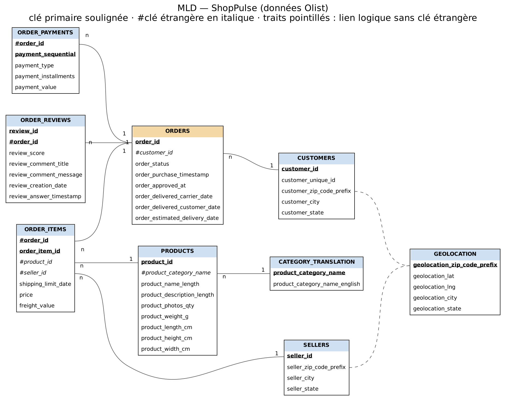

# Modèle logique de données (MLD)

## Notation

Clé primaire en **gras** · clé étrangère précédée de **#**

## Tables

**CUSTOMERS** (**customer_id**, customer_unique_id, customer_zip_code_prefix, customer_city, customer_state)

**ORDERS** (**order_id**, #customer_id, order_status, order_purchase_timestamp, order_approved_at, order_delivered_carrier_date, order_delivered_customer_date, order_estimated_delivery_date)

**ORDER_ITEMS** (**#order_id**, **order_item_id**, #product_id, #seller_id, shipping_limit_date, price, freight_value)

**ORDER_PAYMENTS** (**#order_id**, **payment_sequential**, payment_type, payment_installments, payment_value)

**ORDER_REVIEWS** (**review_id**, **#order_id**, review_score, review_comment_title, review_comment_message, review_creation_date, review_answer_timestamp)

**PRODUCTS** (**product_id**, #product_category_name, product_name_length, product_description_length, product_photos_qty, product_weight_g, product_length_cm, product_height_cm, product_width_cm)

**SELLERS** (**seller_id**, seller_zip_code_prefix, seller_city, seller_state)

**CATEGORY_TRANSLATION** (**product_category_name**, product_category_name_english)

**GEOLOCATION** (**geolocation_zip_code_prefix**, geolocation_lat, geolocation_lng, geolocation_city, geolocation_state)

## Choix de modélisation

- **ORDERS est la table centrale** : une commande appartient à un client et regroupe ses articles, ses paiements et ses avis.
- **customer_id n'est pas le client** : Olist crée un `customer_id` différent à chaque commande. Le vrai client est identifié par `customer_unique_id`, utilisé pour la segmentation RFM.
- **Clés composées** : une commande peut contenir plusieurs articles et plusieurs paiements, d'où les clés (`order_id`, `order_item_id`) et (`order_id`, `payment_sequential`). Un même `review_id` peut apparaître sur plusieurs commandes, d'où la clé (`review_id`, `order_id`).
- **GEOLOCATION** : le fichier contient plusieurs lignes par code postal. Il sera réduit à une ligne par code postal lors du nettoyage. Le lien avec CUSTOMERS et SELLERS se fait par le code postal, sans clé étrangère, car certains codes sont absents.
- **Noms de colonnes** : le CSV d'origine contient une faute (`product_name_lenght`, `product_description_lenght`). Elle est corrigée en `length` dès le schéma raw ; le chargement (COPY) se fait par position de colonne, il n'est donc pas affecté.
